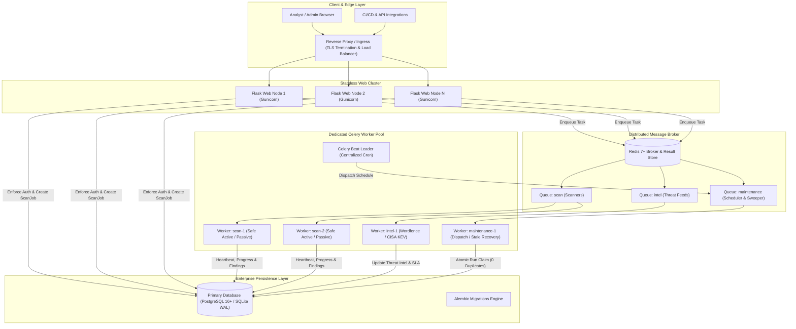
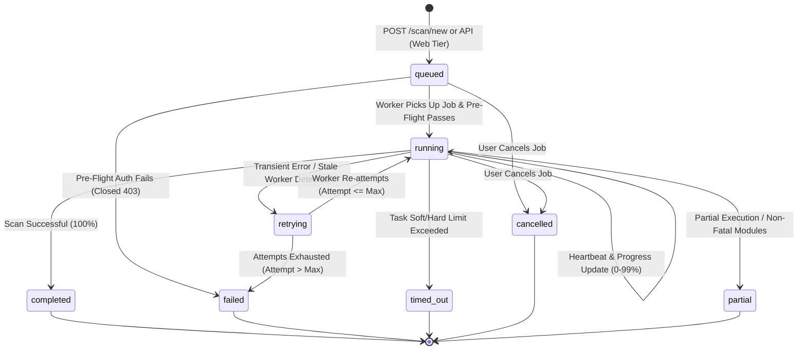
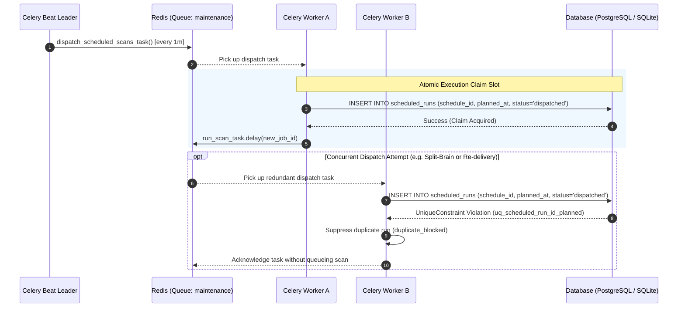

# SentinelWP Enterprise Architecture Specification (Phase 3)

**Version:** 3.8.0-enterprise  
**Status:** Approved & Implemented  
**Classification:** Enterprise High Availability Architecture Document  

---

## 1. Executive Summary

SentinelWP Phase 3 transitions the platform from a single-process Flask + SQLite + ThreadPoolExecutor daemon to a horizontally scalable, production-grade enterprise architecture:

- **Web Tier (Stateless):** Dispatches asynchronous scan workloads; does **NOT** run scanners in the HTTP process.
- **Relational Storage:** Dual-compatible SQLAlchemy 2.x persistence layer with Alembic migrations supporting **PostgreSQL** in production and **SQLite (WAL mode)** for local development and testing.
- **Task Broker & Centralized Queue:** Redis message broker with Celery distributed workers partitioned across dedicated queues (`scan`, `intel`, `maintenance`).
- **High-Availability Scheduling:** Celery Beat centralized scheduler replacing in-process daemons, backed by `ScheduledRun` database-level idempotency constraints to guarantee **0 duplicate scheduled scans**.
- **Resilient Execution Lifecycle:** Persistent `ScanJob` tracking with per-step progress reporting, pre-flight authorization guardrails, automatic heartbeat tracking, crash recovery, timeout controls, and cooperative cancellation.
- **Observability:** Distributed correlation via `X-Request-ID`, structured JSON logging, standard liveness (`/health`), deep readiness (`/ready`), and Prometheus-formatted telemetry (`/metrics`).

---

## 2. Distributed Architecture Diagram

---

## 3. Database Layer & Dual Compatibility

The database architecture is designed with SQLAlchemy 2.0 (`DeclarativeBase`, `Mapped`, `mapped_column`) with explicit multi-database dialect support.

### 3.1 Dialect Switching
- **Production (`DATABASE_URL=postgresql+psycopg://...`):** Uses PostgreSQL 16+ with server-side connection pooling (`QueuePool`, pool size 10, max overflow 20, pool pre-ping enabled).
- **Development/CI (`DATABASE_URL=sqlite:///data/wsa.db`):** Uses SQLite with `NullPool` or `StaticPool`, enforcing `PRAGMA foreign_keys = ON` and `PRAGMA journal_mode = WAL`.

### 3.2 Schema Entities & Isolation
All entities are strictly partitioned by `tenant_id` foreign keys with `ON DELETE CASCADE`.

| Table | Purpose | Primary Key | Critical Indexes / Constraints |
|---|---|---|---|
| `tenants` | Multi-tenant organization boundaries | `id` (UUID) | `uq_tenants_slug` |
| `users` | Role-based identity (admin, analyst, viewer) | `id` (UUID) | `idx_users_tenant`, `uq_users_tenant_username` |
| `assets` | Validated target domains & canonical URLs | `id` (UUID) | `uq_assets_tenant_canonical_url` |
| `scan_authorizations` | Audit authorization windows & profiles | `id` (UUID) | `idx_scan_authorizations_asset_tenant` |
| `scans` | High-level scan execution summaries | `id` (UUID) | `idx_scans_tenant`, `idx_scans_asset` |
| `findings` | Normalised vulnerability detections | `id` (UUID) | `idx_findings_scan`, `idx_findings_tenant` |
| `scan_jobs` | Durable asynchronous execution tracking | `id` (UUID) | `idx_scan_jobs_tenant`, `idx_scan_jobs_status`, `idx_scan_jobs_heartbeat` |
| `scheduled_scans` | Recurring scan schedule definitions | `id` (UUID) | `idx_scheduled_scans_tenant` |
| `scheduled_runs` | Atomic execution slots for HA scheduling | `id` (UUID) | `UNIQUE (schedule_id, planned_at)` |
| `intelligence_sync_status` | Feed ingestion SLA freshness tracking | `id` (source) | SLA freshness calculated against `last_success_at` |
| `audit_events` | Immutable security audit trail | `id` (UUID) | `idx_audit_tenant_created` |

---

## 4. ScanJob Lifecycle & State Machine

Scans follow an explicit, durable state transition machine recorded in the `scan_jobs` table:

### 4.1 State Machine Invariants
1. **Queued at Initiation:** Web tier writes `ScanJob(status=queued)` and enqueues Celery task. The web process never performs active network I/O to the target.
2. **Pre-flight Authorization Re-validation:** When a worker picks up the job from the Redis queue, it re-verifies that the target asset's `ScanAuthorization` has not expired or been revoked in the interval between queueing and execution. If expired, it transitions immediately to `failed` (`error_code="AUTHORIZATION_EXPIRED"`).
3. **Heartbeat Protocol:** Running workers update `heartbeat_at` and `progress_percent` at each scanning stage.
4. **Stale Recovery:** Celery Beat periodically inspects jobs in `running` status whose `heartbeat_at` is older than `stale_threshold_seconds` (default: 600s). If `attempt < max_attempts`, the job is marked `retrying` and re-queued; otherwise it is marked `failed` (`error_code="STALE_WORKER_TIMEOUT"`).
5. **Cooperative Cancellation:** When an analyst triggers `/scan-job/<job_id>/cancel`, the Celery task is revoked with termination signal, and the database status is atomically set to `cancelled`.

---

## 5. High-Availability Scheduler & Zero Duplicates Guarantee

Legacy SentinelWP utilized an in-process Python thread daemon. In multi-replica Kubernetes or containerized environments, multiple web pods caused simultaneous, duplicate scheduled scans.

Phase 3 implements an atomic, database-backed claim mechanism:

**Zero Duplicates Guarantee:**
Even if Celery Beat triggers redundant dispatches across multiple nodes, the unique database constraint `UNIQUE (schedule_id, planned_at)` ensures that exactly **one** execution slot is claimed. Secondary attempts fail with an integrity constraint violation, resulting in zero duplicate scans.

---

## 6. Threat Intelligence Worker Isolation

Threat feed synchronization is executed in the isolated `intel` queue:
- **Source Isolation:** Wordfence API downtime or rate-limiting does not interrupt or fail CISA KEV (Known Exploited Vulnerabilities) or WordPress.org plugin directory ingestion.
- **SLA Freshness Tracking:** The `intelligence_sync_status` table tracks `last_sync_attempt_at`, `last_success_at`, `records_processed`, and computes real-time freshness against `INTEL_FRESHNESS_SLA_HOURS` (default: 24.0h).

---

## 7. Enterprise Observability & Endpoints

| Endpoint | Authentication | Response | Purpose |
|---|---|---|---|
| `GET /health` | Unauthenticated | `{"status": "ok", "app": "SentinelWP", "version": "3.8.0"}` | Liveness probe for Kubernetes and load balancers. |
| `GET /ready` | Unauthenticated | `{"status": "ready", "checks": {"database": "connected", "redis": "connected"}}` | Readiness probe verifying DB connection and Redis ping before routing traffic. |
| `GET /metrics` | Admin / Internal | Prometheus plain-text exposition (`sentinel_scan_jobs_queued`, `sentinel_scan_jobs_running`, etc.) | Prometheus metric scraping for alerting and dashboards. |
| Any HTTP Request | All | Header: `X-Request-ID: <uuid>` | End-to-end request correlation propagated through logs and task metadata. |
