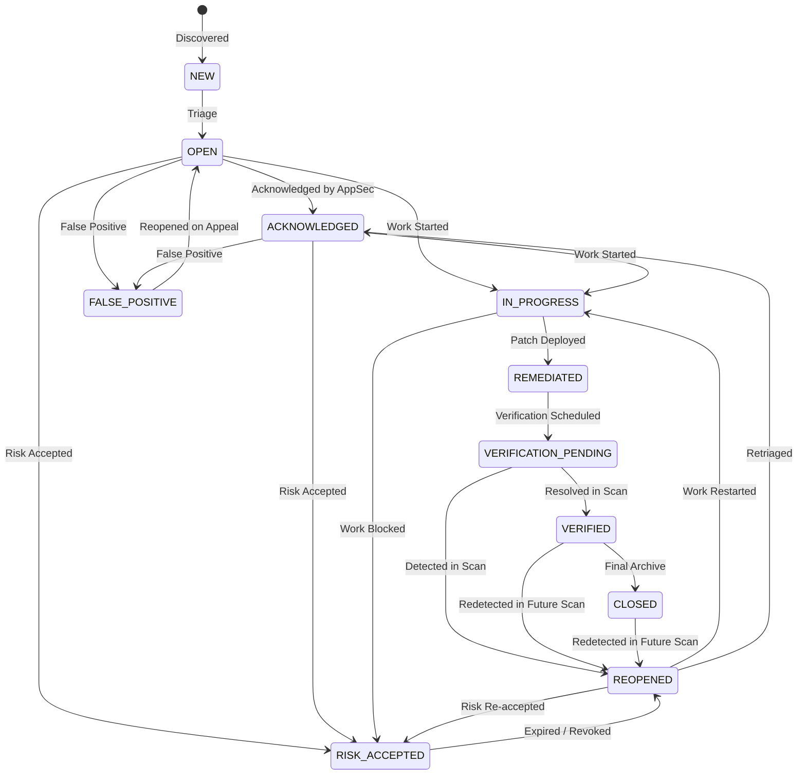

# SentinelWP - Finding Lifecycle & State Machine Specification

## 1. Overview & Architecture

SentinelWP transforms traditional point-in-time scanning into continuous exposure management. At the core of this transformation is the distinction between:
- **Finding**: A persistent, canonical security issue on an asset, tracked across its entire lifecycle from initial discovery to validated remediation.
- **FindingObservation**: An individual detection event recorded during a specific scan run, linking the finding to the scan and immutable evidence reference.

Every finding is uniquely identified and correlated across scans using a deterministic, non-volatile SHA-256 fingerprint:
```
SHA256(tenant_id | asset_id | scanner_id | finding_type | [normalized_component |] normalized_location | normalized_identifier)
```
Volatile fields such as scan IDs, timestamps, or raw dynamic HTTP responses are strictly excluded to ensure stable tracking.

---

## 2. Canonical Finding Lifecycle States



### Complete State Definitions:
1. `NEW`: Initial state upon first observation by any scanner.
2. `OPEN`: Triaged and confirmed as a valid, actionable exposure.
3. `ACKNOWLEDGED`: Assigned to security engineering or product owner.
4. `IN_PROGRESS`: Active engineering work underway to remediate or mitigate.
5. `REMEDIATED`: Engineering team has deployed fix/mitigation.
6. `VERIFICATION_PENDING`: Verification scan scheduled or underway to validate fix.
7. `VERIFIED`: Confirmed resolved by automated verification scan (or manual proof).
8. `RISK_ACCEPTED`: Formal risk acceptance approved under Two-Person Rule; SLA countdown paused.
9. `FALSE_POSITIVE`: Confirmed non-issue with required justification and audit log.
10. `CLOSED`: Terminal archived state.
11. `REOPENED`: Automatically transitioned when a previously verified/closed finding is redetected.

---

## 3. Allowed Transitions Matrix

Any attempt to execute an unauthorized status transition raises `InvalidStateTransitionError` and returns `HTTP 409 Conflict` (Web UI & REST API).

| From State | Allowed Target States |
|:---|:---|
| `NEW` | `OPEN`, `ACKNOWLEDGED`, `FALSE_POSITIVE`, `RISK_ACCEPTED` |
| `OPEN` | `ACKNOWLEDGED`, `IN_PROGRESS`, `REMEDIATED`, `RISK_ACCEPTED`, `FALSE_POSITIVE`, `CLOSED` |
| `ACKNOWLEDGED` | `IN_PROGRESS`, `REMEDIATED`, `RISK_ACCEPTED`, `FALSE_POSITIVE`, `CLOSED` |
| `IN_PROGRESS` | `REMEDIATED`, `VERIFICATION_PENDING`, `RISK_ACCEPTED`, `CLOSED` |
| `REMEDIATED` | `VERIFICATION_PENDING`, `VERIFIED`, `REOPENED`, `IN_PROGRESS` |
| `VERIFICATION_PENDING`| `VERIFIED`, `REOPENED`, `IN_PROGRESS` |
| `VERIFIED` | `CLOSED`, `REOPENED` |
| `RISK_ACCEPTED` | `OPEN`, `REOPENED`, `IN_PROGRESS`, `CLOSED` |
| `FALSE_POSITIVE` | `OPEN`, `REOPENED` |
| `CLOSED` | `REOPENED` |
| `REOPENED` | `ACKNOWLEDGED`, `IN_PROGRESS`, `REMEDIATED`, `RISK_ACCEPTED`, `CLOSED` |

---

## 4. Automatic Reopening & Auto-Resolution

### Automatic Reopening:
When a recurring scan or targeted verification scan detects an issue whose finding is currently in:
- `VERIFIED`
- `CLOSED`
- `REMEDIATED`
- `VERIFICATION_PENDING`

The finding pipeline automatically:
1. Transitions the finding to `REOPENED`.
2. Updates `last_seen_at` and `last_scan_id`.
3. Increments `observation_count`.
4. Creates a new immutable `FindingObservation`.
5. Logs a `finding_reopened` audit entry in `FindingHistory`.
6. Recalculates SLA status and resumes SLA countdown.

### Automatic Verification Resolution:
When a verification scan runs for an asset:
- Any finding currently in `VERIFICATION_PENDING` for that asset that is **NOT** redetected by the scanner is automatically transitioned to `VERIFIED`.
- An audit entry `status_transition` is logged with comment `"Automated verification confirmed resolution in scan <scan_id>"`.

---

## 5. Concurrency Control & Optimistic Locking

To guarantee consistency under concurrent modifications by multiple analysts, API integrations, and background scanners:
- The `findings` table includes an integer `version` column (default `1`).
- Every update executes an atomic SQL query:
  ```sql
  UPDATE findings
  SET status = :new_status, version = version + 1, updated_at = :now
  WHERE id = :id AND version = :expected_version;
  ```
- If `cursor.rowcount == 0`, an `OptimisticLockError` is raised.
- The web interface and REST API catch this and return `HTTP 409 Conflict`, prompting the caller to reload and review concurrent changes.

---

## 6. Audit Trail & Sanitization

- **Append-Only History**: Every creation, status transition, reopening, and policy change appends to `finding_history` with actor, timestamp, previous status, and new status.
- **Comment Sanitization**: All user-submitted comments in `finding_comments` are HTML-escaped (`html.escape`) before persistence, preventing stored XSS.
