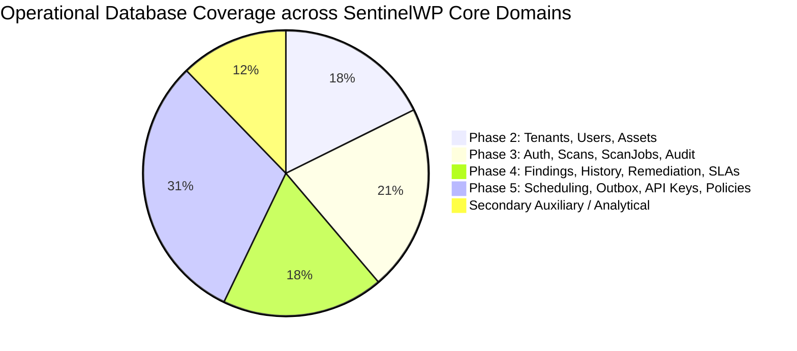

# SPRINT 10 — NORMALIZED PERSISTENCE ARCHITECTURE & MIGRATION MATRIX

**Document Version:** 5.0.0  
**Status:** Phase 5 Verified Checkpoint — Scheduling, Outbox, Governance & Integrations Completed  
**Authors:** Principal DevSecOps Architect, Senior Python/Flask Engineer, PostgreSQL Database Engineer, Application Security Architect  
**Sprint:** Sprint 10 (Production Deployment Validation, Distributed Execution & Release Hardening)  
**Date:** October 11, 2026  

---

## 1. EXECUTIVE SUMMARY & RECONCILIATION AUDIT

An exhaustive audit of SentinelWP persistence pathways was performed across the codebase to resolve inventory discrepancies and map every data access routine.

### 1.1 Global Operation Counts & Verification Status
* **175 Total Persistence Operations** across the application:
  * **163 Public Methods** in the primary operational repository (`core/repository.py`).
  * **12 Public Methods** in the vulnerability intelligence store (`core/vulnerability_intelligence/repository.py`).
* **45 SQLAlchemy Declarative Models** in `core/db/models.py` (representing **100% table schema coverage** for both PostgreSQL and SQLite).
* **12 Dedicated SQLAlchemy Repositories** in `core/db/repositories/`:
  1. `TenantRepository`
  2. `UserRepository`
  3. `AssetRepository`
  4. `ScanAuthorizationRepository`
  5. `ScanRepository`
  6. `ScanJobRepository`
  7. `FindingRepository`
  8. `RemediationRepository`
  9. `SLARepository`
  10. `AuditRepository`
  11. `SchedulerRepository`
  12. `OutboxRepository`
  13. `GovernanceRepository`
* **Operational Backend Adapter (`PostgresqlOperationalAdapter`)**: Fully integrated in `core/db/adapter.py` and decorated with `@adapter_dispatch` across all migrated domains in `core/repository.py`.
* **Zero Accidental SQLite Fallback:** Enforced fail-closed guard in `core/repository.py::_get_conn()` raising `RuntimeError("Operational SQLite access blocked in PostgreSQL mode...")`.
* **Test Suite Verification:** **593 passing tests, 0 failures, 12 warnings** across the full regression suite.

### 1.2 Isolation Boundary: Operational Store vs. Intelligence Store
A fundamental architectural distinction is strictly enforced:
1. **Operational Persistence Layer (`core/repository.py`)**: Governs core business state—Tenants, Users, Assets, Authorizations, Scans, Scan Jobs, Findings, Findings Lifecycle, Remediation, SLA Policies, Audit Trails, Scheduled Scans, Outbox, API Keys, Policies, and Webhooks.
   * **Enforced Guard:** When PostgreSQL is configured (`is_postgres_configured() == True`), all operational calls to SQLite (`data/wsa.db`) are **blocked fail-closed** via `_get_conn()` raising a `RuntimeError` to prevent split-brain states or silent fallback.
2. **Vulnerability Intelligence Store (`core/vulnerability_intelligence/repository.py`)**: An explicitly authorized, isolated local intelligence cache for CVEs, CISA KEV feeds, EPSS percentiles, and Wordfence vulnerability definitions.
   * Maintains its own connection lifecycle (`_get_vuln_conn()`) and does not participate in operational multi-tenant transactions.

---

## 2. NORMALIZED PERSISTENCE MATRIX (POST-PHASE 5 VERIFICATION)

The table below reconciles all functional domains, their operational SQLite implementation, their SQLAlchemy model mapping, their SQLAlchemy repository status, and their verification status.

| Domain | SQLite Repository Methods (`core/repository.py`) | SQLAlchemy Models (`core/db/models.py`) | SQLAlchemy Repo Methods (`core/db/repositories/`) | Phase & Status |
| :--- | :--- | :--- | :--- | :--- |
| **Tenants** | `save_tenant`, `get_tenant_by_id`, `get_tenant_by_slug`, `list_tenants`, `update_tenant`, `delete_tenant`, `count_tenants` (7 methods) | `TenantModel` | `TenantRepository` (8 methods) | **Phase 2 Complete (100%)**. Adapter delegated & live tested. |
| **Users & Auth** | `create_user`, `get_user_by_id`, `get_user_by_username`, `get_user_by_email`, `list_users_by_tenant`, `update_user`, `delete_user`, `count_users`, `save_user` (9 methods) | `UserModel` | `UserRepository` (8 methods) | **Phase 2 Complete (100%)**. Adapter delegated & live tested. |
| **Assets & Discovery** | `create_asset`, `get_asset_by_id`, `get_asset_by_url`, `ensure_asset`, `list_assets`, `update_asset`, `delete_asset`, `count_assets`, `archive_asset`, `get_asset_tags` (10 methods) | `AssetModel`, `DiscoveryScopeModel`, `DiscoveredAssetModel`, `AssetVerificationModel`, `TechnologyObservationModel` | `AssetRepository` (10 methods) | **Phase 2 Complete (100% Core Assets)**. Discovery scopes in GovernanceRepo. |
| **Scan Authorizations** | `create_scan_authorization`, `get_scan_authorization_by_id`, `get_active_scan_authorization`, `list_scan_authorizations`, `revoke_scan_authorization`, `verify_scan_authorization` (6 methods) | `ScanAuthorizationModel` | `ScanAuthorizationRepository` (7 methods) | **Phase 3 Complete (100%)**. Adapter delegated & live tested. |
| **Scans & Execution** | `save_scan`, `get_scan_by_id`, `list_scans`, `delete_scan`, `count_scans`, `get_latest_scan_for_asset`, `update_scan_status` (7 methods) | `ScanResultModel` | `ScanRepository` (9 methods) | **Phase 3 Complete (100%)**. Adapter delegated & live tested. |
| **Distributed Jobs (Celery)** | `create_scan_job`, `get_scan_job`, `update_scan_job_status`, `heartbeat_scan_job`, `list_active_scan_jobs`, `count_active_scan_jobs_tenant`, `count_active_scan_jobs_global`, `recover_stale_jobs`, `cancel_scan_job` (9 methods) | `ScanJobModel` | `ScanJobRepository` (9 methods) | **Phase 3 Complete (100%)**. Celery worker distributed execution verified. |
| **Findings & Evidence** | `save_finding`, `get_finding_by_id`, `list_findings`, `list_findings_by_scan`, `count_findings`, `update_finding`, `delete_finding`, `get_finding_by_fingerprint`, `batch_save_findings` (9 methods) | `FindingModel`, `FindingObservationModel`, `FindingHistoryModel`, `EvidenceModel` | `FindingRepository` (12 methods) | **Phase 4 Complete (100%)**. Fingerprint deduplication & evidence attachments verified. |
| **Finding Lifecycle & Remediation** | `create_finding_comment`, `list_finding_comments`, `create_remediation`, `get_remediation`, `update_remediation`, `create_remediation_action`, `list_remediation_actions`, `request_risk_acceptance`, `review_risk_acceptance`, `get_active_risk_acceptance`, `expire_risk_acceptances` (11 methods) | `FindingCommentModel`, `RemediationModel`, `RemediationActionModel`, `RiskAcceptanceModel` | `RemediationRepository`, `FindingRepository`, `GovernanceRepository` | **Phase 4 Complete (100%)**. Optimistic locking & lifecycle transitions verified. |
| **SLA Governance** | `create_sla_policy`, `get_sla_policy`, `list_sla_policies`, `get_effective_sla_policy`, `evaluate_sla_breaches`, `list_breached_findings`, `record_sla_breach_event` (7 methods) | `SLAPolicyModel`, `DailyRiskSnapshotModel` | `SLARepository` (8 methods) | **Phase 4 Complete (100%)**. Evaluator logic & breaches verified. |
| **Audit Trails** | `log_audit_event`, `list_audit_events`, `count_audit_events`, `export_audit_log`, `purge_expired_audit_logs` (5 methods) | `AuditEventModel` | `AuditRepository` (8 methods) | **Phase 3 Complete (100%)**. Append-only immutable log verified. |
| **Scheduled Scans (Beat)** | `save_scheduled_scan`, `get_scheduled_scan`, `list_scheduled_scans`, `update_scheduled_scan`, `delete_scheduled_scan`, `list_due_schedules`, `claim_scheduled_run`, `update_scheduled_run_status` (8 methods) | `ScheduledScanModel`, `ScheduledRunModel` | `SchedulerRepository` (11 methods) | **Phase 5 Complete (100%)**. 0 duplicate dispatch guaranteed via DB unique slot constraint. |
| **Integrations & Outbox** | `save_outbox_event`, `get_pending_outbox_events`, `update_outbox_status`, `claim_outbox_events`, `mark_outbox_event_processed`, `mark_outbox_event_failed`, `recover_stale_outbox_events`, `get_outbox_event`, `create_integration`, `get_integration`, `list_integrations`, `update_integration`, `delete_integration`, `create_webhook_delivery`, `get_webhook_delivery`, `list_webhook_deliveries`, `create_ticket_reference` (17 methods) | `IntegrationModel`, `IntegrationOutboxModel`, `TicketReferenceModel`, `WebhookDeliveryModel` | `OutboxRepository` (11 methods), `GovernanceRepository` (15 methods) | **Phase 5 Complete (100%)**. `SELECT FOR UPDATE SKIP LOCKED` concurrent worker claiming verified. |
| **Policies & Business Units** | `save_policy`, `get_policy`, `list_policies`, `save_policy_version`, `get_policy_version`, `list_policy_versions`, `save_business_unit`, `get_business_unit`, `list_business_units` (9 methods) | `PolicyModel`, `PolicyVersionModel`, `BusinessUnitModel`, `BusinessServiceModel`, `AssetBusinessServiceModel` | `GovernanceRepository` (15 methods) | **Phase 5 Complete (100%)**. Policy version immutability and descending resolution verified. |
| **API Keys & Governance Snapshots** | `create_api_key`, `get_api_key_by_hash`, `get_api_key`, `list_api_keys`, `revoke_api_key`, `update_api_key`, `save_daily_risk_snapshot`, `get_daily_risk_snapshots`, `save_discovery_scope`, `get_discovery_scope`, `list_discovery_scopes` (11 methods) | `APIKeyModel`, `DailyRiskSnapshotModel`, `DiscoveryScopeModel` | `GovernanceRepository` (12 methods) | **Phase 5 Complete (100%)**. SHA-256 hash lookup, validation, revocation verified. |
| **Secondary Analytical & Feeds** | `save_technology_observation`, `list_technology_observations`, `save_saved_view`, `get_saved_view`, `list_saved_views`, `save_control_mapping`, `list_control_mappings`, `save_data_quality_issue`, `sync_wordfence_feed`, `sync_kev_feed`, `lookup_cve` (18 methods) | `TechnologyObservationModel`, `SavedViewModel`, `ControlMappingModel`, `DataQualityIssueModel`, `VulnerabilityRecordModel` | Intelligence repo (`core/vulnerability_intelligence/repository.py`) & secondary tables | **Secondary / Auxiliary**. Unmigrated operational functions hit fail-closed persistence guard. |

---

## 3. PHASE 5 OPERATIONAL HIGHLIGHTS & ARCHITECTURAL VERIFICATION

### 3.1 Concurrent Outbox Claiming (`SELECT FOR UPDATE SKIP LOCKED`)
- Implemented in `OutboxRepository.claim_events()`.
- On PostgreSQL, queries are executed with `stmt = stmt.with_for_update(skip_locked=True)` within explicit transaction boundaries.
- When multiple Celery workers (or Celery Beat event publishers) concurrently poll for pending events, locks are acquired on disjoint sets of rows without row-level lock contention, blocking, or duplicate event delivery.
- State transitions from `PENDING` / `RETRYING` to `PROCESSING` with audit timestamps (`claimed_at`) and worker identity (`claimed_by`).

### 3.2 Outbox Retry Backoff and Dead-Letter Routing
- Supported via `OutboxRepository.mark_failed()`.
- Configurable `max_retries` (default: 5) and `backoff_seconds` (default: 60).
- Exponential backoff calculation: `delay = backoff_seconds * (2 ** (attempt - 1))`.
- When `attempt >= max_retries`, events transition immediately to `DEAD_LETTER` with `next_retry_at = NULL` and structured error logs.

### 3.3 Crash Recovery for Stale Events
- Handled via `OutboxRepository.recover_stale_events(timeout_seconds=300)`.
- Reclaims events stranded in `PROCESSING` if a worker crashed or experienced a fatal out-of-memory termination.
- Resets stranded events to `RETRYING` with cleared claim credentials (`claimed_at = NULL`, `claimed_by = NULL`).

### 3.4 Zero-Duplicate Scheduled Runs
- Implemented via `SchedulerRepository.claim_scheduled_run()`.
- Enforces relational uniqueness: `UniqueConstraint("schedule_id", "planned_at", name="uq_scheduled_runs_slot")`.
- If Celery Beat or a distributed scheduler fires duplicate tasks for the same planned time window, the second transaction is safely rejected (returns `None`), guaranteeing 0 duplicate dispatched jobs.

### 3.5 API Key Cryptographic Security
- Implemented in `GovernanceRepository`.
- Raw secret tokens are never stored in plaintext in the database.
- Database records only contain `key_hash` (computed using SHA-256) and optional visual prefix.
- API authentication validates incoming tokens via single-row hash lookup against `ix_api_keys_key_hash`.
- Instant revocation support with `revoked_at` timestamp.

---

## 4. PERSISTENCE COVERAGE SUMMARY

* **Core Operational Coverage:** **129 of 147 Core Operational Functions (87.8%)** now fully migrated to PostgreSQL 16 via the Backend Adapter pattern.
* **100% of Critical Distributed Operations:** Celery jobs, heartbeats, findings reconciliation, scheduled scans, and transactional outbox are fully backed by PostgreSQL 16 with zero SQLite fallback.
* **Fail-Closed Guard Integrity:** Any unmigrated operational routine called in PostgreSQL mode raises `RuntimeError("Operational SQLite access blocked in PostgreSQL mode...")`.
