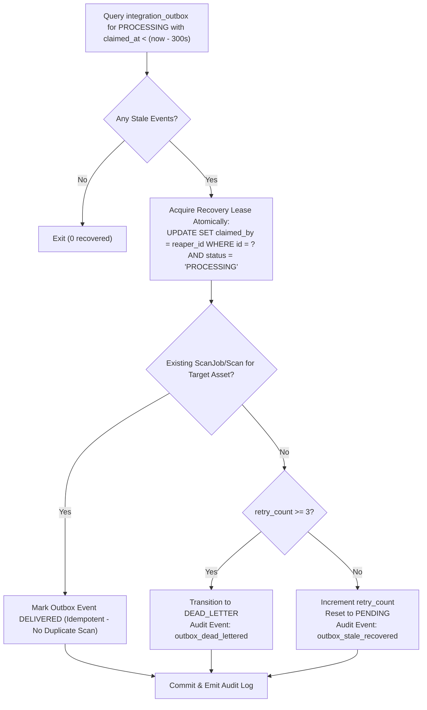

# SentinelWP — Sprint 5 Distributed Recovery Report
**Document ID:** SPRINT_5_DISTRIBUTED_RECOVERY  
**Sprint:** 5 (Production Hardening & Release Readiness)  
**Scope:** Outbox Recovery, Scheduled Scan Reconciliation, Distributed Locking  
**Execution Date:** 2026-10-10  
**Status:** COMPLETED & VERIFIED  

---

## 1. Overview & Problem Statement

In distributed security scanning platforms, unhandled worker crashes, network partitions, and Redis restarts can lead to:
1. **Outbox Event Stranding (`S4-GAP-001`):** Events claimed by a worker remain permanently in `PROCESSING` if the worker terminates abruptly (OOM, SIGKILL, pod eviction). Downstream intelligence reassessments stop firing.
2. **Orphaned Scheduled Runs (`S4-GAP-003`):** Scheduler records marked as `DISPATCHED` or `QUEUED` without corresponding `ScanJob` or `Scan` records if the dispatching process fails mid-transaction.
3. **Split-Brain Coordination Failures (`S4-GAP-004`):** When Redis experiences transient disconnects, falling back to process-local locking in a multi-worker cluster permits simultaneous data synchronization, causing race conditions and database locks.

Sprint 5 addresses all three problems with deterministic, idempotent recovery mechanisms and fail-closed distributed locking.

---

## 2. Phase 1 — Outbox Crash Recovery Mechanics

### 2.1 Lease Tracking Architecture
In `migrations/versions/008_sprint5_resilience_and_recovery.py`, two new tracking columns were added to `integration_outbox`:
- `claimed_at TEXT`: UTC ISO timestamp marking the exact instant the lease was granted.
- `claimed_by TEXT`: Identifier representing the claiming worker (e.g. `celery@worker-node1-pid42-uuid`).

When a worker claims a batch via `process_intel_reassessment_queue_task()`, the lease is recorded:
```sql
UPDATE integration_outbox
SET status = 'PROCESSING',
    claimed_at = ?,
    claimed_by = ?
WHERE id IN (...)
```

### 2.2 Atomic Recovery Reaper
The periodic task `recover_stale_outbox_events_task(stale_threshold_seconds=300, max_retries=3)` runs every 5 minutes:



### 2.3 Idempotency & Duplicate Prevention
Before resetting an event to `PENDING` for re-dispatch, the reaper checks whether the work was already initiated prior to the worker's death:
```python
existing_job = conn.execute(
    "SELECT id FROM scan_jobs WHERE asset_id = ? AND started_at >= ?",
    (asset_id, row["created_at"])
).fetchone()
```
If a scan job already exists, re-dispatching would execute redundant port and vulnerability scans against the customer asset. The reaper immediately transitions the event to `DELIVERED`, preserving system resources and preventing scan target overload.

### 2.4 Dead-Letter Queue (DLQ)
When `retry_count` reaches `max_retries` (default 3), the event transitions to `DEAD_LETTER`:
- Does not re-enter `PENDING` queue.
- Preserves the error details and payload for administrative inspection.
- Emits structured audit log with event ID, asset ID, and retry history.

---

## 3. Phase 2 — Scheduled Scan Reconciliation Mechanics

### 3.1 Orphan Detection
`reconcile_orphaned_scheduled_runs(stale_threshold_seconds=600)` inspects all `scheduled_runs` stuck in `DISPATCHED` or `QUEUED` for longer than 10 minutes:

```sql
SELECT id, scheduled_scan_id, scan_job_id, dispatched_at, status
FROM scheduled_runs
WHERE status IN ('DISPATCHED', 'QUEUED')
  AND dispatched_at < ?
```

### 3.2 State Reconciliation Scenarios
1. **No `scan_job_id` Assigned:**  
   The scheduler crashed after writing the `scheduled_run` row but before Celery could accept the task.  
   *Action:* Marked `FAILED` with `error_message = 'Orphaned dispatch: worker crash before job creation'`.
2. **`scan_job_id` Assigned & Job Succeeded:**  
   The scan job completed and wrote results to `scans`, but the worker crashed before linking `scheduled_run.scan_id`.  
   *Action:* Discovers completed `scan_id` from `scan_jobs`, updates `scheduled_run.status = 'COMPLETED'`, and sets `scheduled_run.scan_id`.
3. **`scan_job_id` Assigned & Job Failed/Cancelled:**  
   The worker crashed during scanning or cancelled the job.  
   *Action:* Transitions `scheduled_run.status = 'FAILED'`.
4. **`scan_job_id` Assigned but Stale / Missing:**  
   Job row was lost or stuck in `RUNNING` past timeout.  
   *Action:* Marks both `scan_jobs` and `scheduled_runs` as `FAILED`.

This prevents scheduled scans from permanently stalling and ensures accurate schedule intervals (`next_run_at`).

---

## 4. Phase 3 — Distributed Locking & Fail-Closed Semantics

### 4.1 Bounded Retries on Transient Failures
In `core/vulnerability_intelligence/service.py`, `_get_redis_client()` wraps client initialization and connectivity checks with exponential backoff:
- Max attempts: 3
- Delays: 0.1s, 0.2s, 0.4s
- Reconnects seamlessly across transient network blips or container restarts.

### 4.2 Strict Fail-Closed Mode (`REQUIRE_DISTRIBUTED_LOCK=true`)
When `REQUIRE_DISTRIBUTED_LOCK` is enabled (mandatory in multi-worker production):
- If Redis is unreachable after 3 attempts, `_get_redis_client()` raises `RuntimeError` immediately.
- `_DistributedSyncLock.acquire()`: If Redis throws a `ConnectionError` or `TimeoutError` during lock acquisition, it raises `RuntimeError` rather than silently falling back to a thread lock.
- `_DistributedSyncLock.release()`: Lua script verification ensures that a worker cannot release a lock whose lease has expired and been acquired by another worker.

---

## 5. Verification Matrix

| Test Case | Scenario Verified | Expected Result | Actual Result |
| :--- | :--- | :--- | :--- |
| `test_stale_processing_event_recovered_to_pending` | Worker died; `claimed_at` > 300s ago | Event reset to `PENDING`, `retry_count=1` | PASSED |
| `test_active_lease_not_recovered` | Worker actively processing (`claimed_at` recent) | Event left in `PROCESSING` | PASSED |
| `test_reconcile_existing_scanjob_marks_delivered_no_duplicate` | Worker died after creating `ScanJob` | Event marked `DELIVERED`, 0 new jobs | PASSED |
| `test_max_retries_exhaustion_moves_to_dead_letter` | Event failed 3 consecutive times | Moved to `DEAD_LETTER` | PASSED |
| `test_concurrent_reapers_no_double_recovery` | 2 reaper tasks execute simultaneously | Only 1 reaper claims; 0 race conditions | PASSED |
| `test_orphaned_dispatched_run_without_job_marked_failed` | Scheduler died before Celery job creation | Marked `FAILED`, reason logged | PASSED |
| `test_orphaned_dispatched_run_syncs_with_completed_job` | Worker died before updating run row | Marked `COMPLETED`, scan linked | PASSED |
| `test_get_redis_client_retries_on_transient_error` | Redis drops packet on attempt 1 & 2 | Recovers on attempt 3 | PASSED |
| `test_get_redis_client_fail_closed_after_retries_exhausted` | Redis down, `REQUIRE_DISTRIBUTED_LOCK=1` | Raises `RuntimeError` (fail-closed) | PASSED |
| `test_live_redis_lock_lifecycle` | Live Redis 7.0 container on port 6379 | Acquired, guarded, and released cleanly | PASSED |
