# SentinelWP — Sprint 5 Feature Consolidation & Information Architecture Plan
**Document ID:** SPRINT_5_FEATURE_CONSOLIDATION  
**Sprint:** 5 (Production Hardening & Consolidation Planning)  
**Execution Date:** 2026-10-10  
**Status:** ARCHITECTURAL SPECIFICATION READY FOR SPRINT 6  

---

## 1. Executive Summary

SentinelWP currently exposes 14 flat navigation items and 26 distinct Jinja templates. This document specifies the consolidation of the user interface into **6 unified functional workspaces**. 

Every existing feature, metric, action, filter, and backend route will be preserved. Consolidation will eliminate screen-switching overhead, streamline repetitive workflows, and align SentinelWP with modern enterprise security platforms (such as CrowdStrike Falcon, Wiz, and Tenable).

---

## 2. Navigation Consolidation Blueprint

```mermaid
flowchart TD
    subgraph CURRENT_14_LINKS["Current Fragmented Navigation (14 Links)"]
        D1["Dashboard"]
        D2["Portfolio"]
        A1["Asset Inventory"]
        F1["Findings"]
        R1["Remediation"]
        S1["SLA Governance"]
        E1["Exceptions"]
        SC1["New Scan"]
        SC2["Batch Scan"]
        SC3["Scan History"]
        SC4["Schedules"]
        TI1["Threat Intel"]
        DQ1["Data Quality"]
        AL1["Audit Log"]
    end

    subgraph FUTURE_6_WORKSPACES["Consolidated Navigation (6 Workspaces)"]
        W1["1. Overview<br/>(Posture, Portfolio & Executive Reports)"]
        W2["2. Assets<br/>(Inventory, Business Units & Data Quality)"]
        W3["3. Vulnerabilities<br/>(Triage, Remediation, SLA & Exceptions)"]
        W4["4. Operations & Scans<br/>(Scan Launcher, Queue, History & Schedules)"]
        W5["5. Threat Intelligence<br/>(Feeds, CVE Database & Reassessment)"]
        W6["6. Administration<br/>(Users, Tenants, API Keys & Audit Trail)"]
    end

    D1 --> W1
    D2 --> W1
    A1 --> W2
    DQ1 --> W2
    F1 --> W3
    R1 --> W3
    S1 --> W3
    E1 --> W3
    SC1 --> W4
    SC2 --> W4
    SC3 --> W4
    SC4 --> W4
    TI1 --> W5
    AL1 --> W6
```

---

## 3. Detailed Workspace Mapping & Tab Architecture

### Workspace 1: Overview (`/`)
- **Purpose:** Central executive and operational command center.
- **Integrated Views & Sub-Tabs:**
  - **Tab A: Executive Posture:** Aggregated risk score, total active vulnerabilities, open P1/P2 findings, compliance percentage, recent critical alerts.
  - **Tab B: Business Units:** Departmental risk breakdown, asset distribution by business unit, ownership coverage (replaces `/portfolio`).
  - **Tab C: Executive Reports:** One-click download of executive PDF/HTML report, historical posture trends (replaces `/reports/executive`).
- **Retired Top-Level Links:** `Dashboard`, `Portfolio`.

### Workspace 2: Assets (`/assets`)
- **Purpose:** Complete attack surface and WordPress asset inventory.
- **Integrated Views & Sub-Tabs:**
  - **Tab A: All Assets:** Primary inventory table with real-time filters (criticality, exposure, WordPress version, business unit).
  - **Tab B: Asset Groups / Business Units:** Management of corporate organizational units.
  - **Tab C: Data Quality & Verification:** Verification status, ownership coverage, telemetry confidence (replaces `/data-quality`).
- **Interactive Actions:**
  - "Add Asset" button opens modal dialog (replaces standalone `/asset/new` page).
  - "Scan Asset" instant action from table row (pre-fills scan launcher).
- **Retired Top-Level Links:** `Data Quality`.

### Workspace 3: Vulnerabilities (`/findings`)
- **Purpose:** Comprehensive vulnerability triage, remediation governance, and exception handling.
- **Integrated Views & Sub-Tabs:**
  - **Tab A: Triage (Active Findings):** Master findings table with multi-factor filters (severity, CVE, KEV, SLA status).
  - **Tab B: Remediation Backlog:** Work assignment, Jira/ticket status, remediation velocity (replaces `/remediation`).
  - **Tab C: SLA Governance:** Due date countdowns, breach tracking, compliance KPIs (replaces `/sla`).
  - **Tab D: Risk Exceptions:** Accepted risks, expiration countdowns, pending approvals (replaces `/risk-acceptances`).
- **Retired Top-Level Links:** `Remediation`, `SLA Governance`, `Exceptions`.

### Workspace 4: Operations & Scans (`/scans`)
- **Purpose:** Full lifecycle management of vulnerability discovery jobs.
- **Integrated Views & Sub-Tabs:**
  - **Tab A: Scan History:** Filterable table of past and active executions with live progress bars.
  - **Tab B: Schedules:** Recurring scan calendar and cron management (replaces `/schedules`).
- **Unified Scan Launcher (Modal / Drawer):**
  - Consolidates `/scan/new` and `/scan/batch` into a single intuitive launcher:
    - Mode toggle: *Single Asset* vs. *Batch URLs* vs. *Asset Group*.
    - Profile selection: *Passive Discovery*, *Safe Active*, *Full Penetration*.
- **Retired Top-Level Links:** `New Scan`, `Batch Scan`, `Schedules`.

### Workspace 5: Threat Intelligence (`/vuln-intel`)
- **Purpose:** Global vulnerability feeds, CISA KEV alerts, and automated reassessment telemetry.
- **Integrated Views & Sub-Tabs:**
  - **Tab A: Feed Telemetry:** CISA KEV, NVD, Wordfence sync health, last sync timestamps, manual "Sync Now" trigger.
  - **Tab B: CVE Knowledgebase:** Searchable database of WordPress core, plugin, and theme advisories.
  - **Tab C: Reassessment Queue:** Outbox queue status, automatic re-scan triggers, dead-letter count.

### Workspace 6: Administration & Settings (`/settings`)
- **Purpose:** Platform configuration, tenant management, access control, and compliance.
- **Integrated Views & Sub-Tabs:**
  - **Tab A: User Management:** User directory, roles, invite modal (replaces `/users`).
  - **Tab B: Tenant & Workspaces:** Multi-tenant configuration, offboarding, workspace branding.
  - **Tab C: API & Webhooks:** API key creation/rotation, outgoing webhook endpoints.
  - **Tab D: Audit Trail:** Immutable security log with search and export (replaces `/audit`).
- **Retired Top-Level Links:** `Audit Log`.

---

## 4. Current vs. Future Route & Template Matrix

| Current Template | Current Route | Future Workspace & View | Functionality Preserved |
| :--- | :--- | :--- | :---: |
| `dashboard.html` | `/` | `Workspace 1: Overview (Tab A)` | 100% |
| `portfolio_dashboard.html` | `/portfolio` | `Workspace 1: Overview (Tab B)` | 100% |
| `executive_report.html` | `/reports/executive` | `Workspace 1: Overview (Tab C)` | 100% |
| `assets.html` | `/assets` | `Workspace 2: Assets (Tab A)` | 100% |
| `asset_form.html` | `/asset/new` | `Workspace 2: Asset Modal` | 100% |
| `data_quality_dashboard.html`| `/data-quality` | `Workspace 2: Assets (Tab C)` | 100% |
| `findings.html` | `/findings` | `Workspace 3: Vulnerabilities (Tab A)` | 100% |
| `remediation.html` | `/remediation` | `Workspace 3: Vulnerabilities (Tab B)` | 100% |
| `sla.html` | `/sla` | `Workspace 3: Vulnerabilities (Tab C)` | 100% |
| `risk_acceptances.html` | `/risk-acceptances` | `Workspace 3: Vulnerabilities (Tab D)` | 100% |
| `scan_history.html` | `/scans` | `Workspace 4: Operations (Tab A)` | 100% |
| `schedules.html` | `/schedules` | `Workspace 4: Operations (Tab B)` | 100% |
| `new_scan.html` | `/scan/new` | `Workspace 4: Scan Launcher Drawer` | 100% |
| `batch_scan.html` | `/scan/batch` | `Workspace 4: Scan Launcher Drawer` | 100% |
| `vuln_intel_dashboard.html` | `/vuln-intel` | `Workspace 5: Threat Intel (Tab A)` | 100% |
| `vuln_intel_list.html` | `/vuln-intel/list` | `Workspace 5: Threat Intel (Tab B)` | 100% |
| `settings.html` | `/settings` | `Workspace 6: Administration` | 100% |
| `users.html` | `/users` | `Workspace 6: Administration (Tab A)` | 100% |
| `audit.html` | `/audit` | `Workspace 6: Administration (Tab D)` | 100% |

---

## 5. Non-Functional Guarantees for Sprint 6

1. **Zero Backward Compatibility Breakage:**
   - Existing bookmarks and direct URLs (e.g. `/portfolio`, `/sla`, `/audit`) will gracefully redirect (302/301) to the new consolidated workspace tabs.
2. **Zero Backend API Changes:**
   - All RESTful endpoints (`/api/v1/findings`, `/api/v1/assets`, etc.) remain 100% identical and untouched.
3. **No Database Schema Alterations:**
   - The UI consolidation is strictly a presentation-layer upgrade; no database migrations are required for Sprint 6 UI consolidation.
