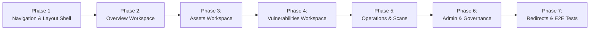

# SentinelWP — Sprint 6 UX Consolidation Roadmap
**Document ID:** SPRINT_6_UX_ROADMAP  
**Sprint:** 6 (Enterprise UX Consolidation & Workflow Streamlining)  
**Execution Plan:** Phased Implementation Blueprint  
**Date Created:** 2026-10-10  
**Status:** APPROVED ARCHITECTURAL SPECIFICATION FOR SPRINT 6  

---

## 1. Vision & Objectives

Sprint 6 is dedicated exclusively to **streamlining the SentinelWP user interface and information architecture**. 

### Core Objectives:
1. **Reduce Navigation Complexity:** Collapse 14 flat sidebar links into 6 intuitive, role-aligned workspaces.
2. **Eliminate Dashboard Fragmentation:** Unify 5 disconnected reporting screens into cohesive, tabbed views.
3. **Consolidate Workflows:** Introduce modal drawers for Asset creation and Scan launching (single & batch).
4. **Preserve 100% Backend Parity:** Zero database schema modifications; zero breaking changes to existing REST endpoints; automatic 301/302 redirects for legacy URLs.

---

## 2. Phased Implementation Roadmap

---

### Phase 1 — Navigation & Layout Shell Redesign
- **Target File:** `templates/base.html`
- **Actions:**
  - Redesign left sidebar to display 6 primary workspace items with high-contrast icons and active states:
    1. Overview (`/`)
    2. Assets (`/assets`)
    3. Vulnerabilities (`/findings`)
    4. Operations (`/scans`)
    5. Threat Intel (`/vuln-intel`)
    6. Settings & Admin (`/settings`)
  - Add workspace badge, collapse toggle, and clean user profile dropdown in footer.
  - Implement mobile-responsive sliding drawer for viewports < 768px.

---

### Phase 2 — Workspace 1: Overview Consolidation
- **Target File:** `templates/dashboard.html`
- **Actions:**
  - Introduce top-level tabs:
    - **Posture Overview:** Core metrics (total findings, critical vulnerabilities, open P1/P2, SLA compliance percentage).
    - **Business Units:** Embedded departmental posture cards and risk score breakdown (from `portfolio_dashboard.html`).
    - **Executive Summary:** One-click PDF/HTML export button and trend graphs (from `executive_report.html`).
  - Deprecate `/portfolio` as a standalone top-level sidebar link (redirect to `/?tab=portfolio`).

---

### Phase 3 — Workspace 2: Assets & Attack Surface
- **Target File:** `templates/assets.html`
- **Actions:**
  - Introduce sub-tabs:
    - **Inventory:** Master asset table with inline search, criticality badges, and "Quick Scan" button.
    - **Business Units:** Organizational group manager.
    - **Data Quality:** Embedded confidence scores, ownership coverage, and verification rate (from `data_quality_dashboard.html`).
  - Replace `/asset/new` with an accessible slide-over modal dialog directly on `/assets`.
  - Deprecate `/data-quality` as a standalone top-level sidebar link (redirect to `/assets?tab=quality`).

---

### Phase 4 — Workspace 3: Vulnerabilities & Remediation
- **Target File:** `templates/findings.html`
- **Actions:**
  - Introduce sub-tabs:
    - **Triage (Active):** High-efficiency findings table with bulk action toolbar (Assign, Accept Risk, Mark False Positive).
    - **Remediation Backlog:** Work assignments, ticket status, remediation velocity (from `remediation.html`).
    - **SLA Governance:** Days-to-breach timers, compliance metrics (from `sla.html`).
    - **Risk Exceptions:** Active and expired waivers table (from `risk_acceptances.html`).
  - Deprecate standalone sidebar links: `Remediation`, `SLA Governance`, `Exceptions`.

---

### Phase 5 — Workspace 4: Operations & Scans
- **Target File:** `templates/scan_history.html` (renamed/aliased to `templates/operations.html`)
- **Actions:**
  - Introduce sub-tabs:
    - **Scan History & Live Queue:** Real-time table of running and completed scans with live progress indicators.
    - **Recurring Schedules:** Schedule table with interval editor and pause/resume switches (from `schedules.html`).
  - Build **Unified Scan Launcher Modal**:
    - Triggered via primary "+ New Scan" header button.
    - Segmented selector: Single Asset Scan vs. Multi-Target Batch Scan vs. Scheduled Job.
    - Profile selection: Passive, Safe Active, Full.
  - Deprecate standalone sidebar links: `New Scan`, `Batch Scan`, `Schedules`.

---

### Phase 6 — Workspace 5 & 6: Threat Intel & Administration
- **Threat Intel (`templates/vuln_intel_dashboard.html`):**
  - Add sub-tabs for Feed Health telemetry and CVE Advisory Database search (`vuln_intel_list.html`).
- **Administration (`templates/settings.html`):**
  - Add sub-tabs: General Settings, User Management (`users.html`), Tenant & Workspaces, API Keys, and Audit Trail (`audit.html`).
  - Deprecate standalone sidebar link: `Audit Log` (integrated into Admin tab).

---

### Phase 7 — Routing, Legacy Redirects & E2E Validation
- **Target File:** `app.py`, `tests/test_ui_consolidation.py`
- **Actions:**
  - Add graceful HTTP 302 redirects for legacy routes (`/portfolio`, `/remediation`, `/sla`, `/data-quality`, `/schedules`, `/audit`) pointing to their new tabbed destinations.
  - Write Playwright / Flask test suite verifying:
    - All 6 workspaces render cleanly with HTTP 200.
    - All legacy routes redirect properly without breaking saved bookmarks.
    - Modals (Add Asset, Scan Launcher) trigger and submit payloads successfully.
    - Zero console JavaScript errors.

---

## 3. Acceptance Criteria for Sprint 6

| Metric | Target Goal |
| :--- | :--- |
| **Top-Level Sidebar Links** | Exactly 6 items (down from 14). |
| **Standalone Dashboards** | 1 consolidated overview (down from 5). |
| **Scanning Entrypoints** | 1 unified launch modal (down from 3 disparate forms). |
| **Legacy Route Compatibility** | 100% of previous endpoints redirect or render correctly. |
| **API Endpoints Affected** | 0 breaking changes to `/api/v1/...`. |
| **Test Suite Health** | 100% tests passing (0 regressions). |

---

## 4. Execution Guidance

> [!IMPORTANT]
> Sprint 6 implementation must proceed incrementally. Each phase must be verified by automated tests before proceeding to subsequent workspaces. No production databases or external target websites should be modified.
